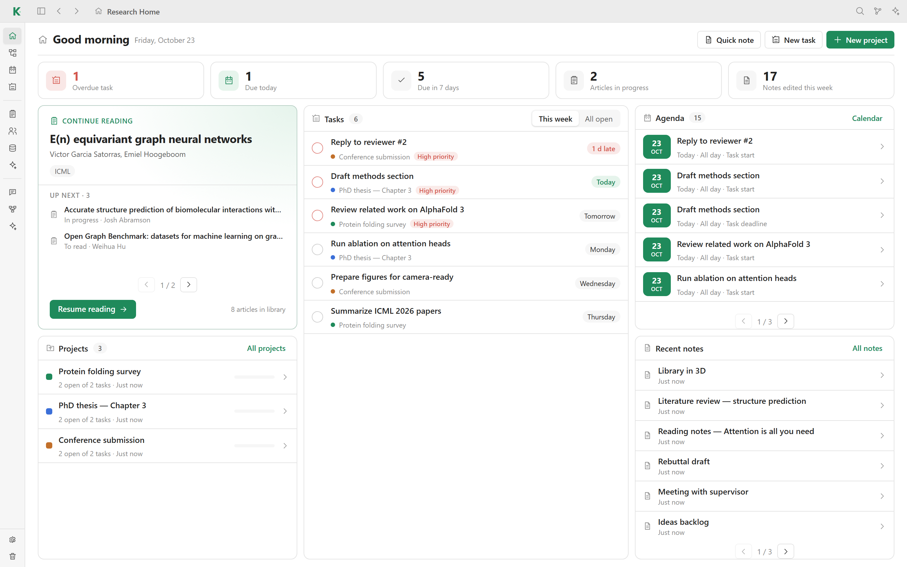

<div align="center">


# Kavot

**A local-first workspace for research projects.**
Articles, PDFs, notes, canvases, tasks and agent workflows in one desktop app,
stored as plain files in a folder you own.

[**Download**](https://kavot.cloud) · [Website](https://kavot.cloud) · [Report a bug](https://github.com/Ttibo/Kavot/issues) · [Contribute](CONTRIBUTING.md)


<br>



</div>

---

> [!TIP]
> More screenshots, the feature tour and ready-to-install downloads are on **[kavot.cloud](https://kavot.cloud)**.
> This repository holds the source code of the desktop app.

## Why Kavot

- **Local first.** No account and no server needed. Everything lives in a folder you
  choose: JSON, HTML and PDF files that you can back up, version or open without Kavot.
- **One place for a research project.** A library and PDF reader, notes, canvases,
  tasks, a calendar and custom collections, all linked to each other. Each project
  opens on its own canvas.
- **Notes that outlive the app.** Notes are standalone HTML documents that open in any
  browser.
- **Agents on your terms.** Connect an agent already installed on your computer
  (Claude Code, Codex or OpenCode). It reads your workspace through a local
  [MCP server](app/docs/mcp-local.md) and only *proposes* changes, which you approve.
- **No tracking.** Kavot sends no telemetry and no analytics.

## Features

Each feature has its own page with screenshots and details.

| Feature | What it does | |
| --- | --- | --- |
| 📚 **[Library](docs/library.md)** | Import a Zotero library, organize articles in folders, read and annotate PDFs | [Details →](docs/library.md) |
| 🔎 **[Discovery](docs/discovery.md)** | Search scholarly sources and explore citation graphs | [Details →](docs/discovery.md) |
| 🛰️ **[Watchers](docs/watchers.md)** | Scheduled watches that find new articles, conferences or items for your collections | [Details →](docs/watchers.md) |
| ⚙️ **[Workflows](docs/workflows.md)** | Chain sources, agent steps (summarize, filter, extract, compare, build) and outputs (notes, tasks, collections, files). Every run keeps the output of each step | [Details →](docs/workflows.md) |
| 💬 **[Assistant](docs/assistant.md)** | Chat with your agent about the open note, project or library; changes wait for your approval | [Details →](docs/assistant.md) |
| 📝 **[Live notes](docs/notes.md)** | Rich editor with math, collection views (table, list, gallery, kanban), sandboxed scripts (even a three.js scene) and a drawing studio | [Details →](docs/notes.md) |
| 🧭 **[Canvases](docs/canvases.md)** | Lay out notes, articles, tasks and links between them on an infinite canvas | [Details →](docs/canvases.md) |
| ✅ **[Planning](docs/planning.md)** | Tasks, kanban boards, a calendar, conferences and datasets | [Details →](docs/planning.md) |
| 🗂️ **[Collections](docs/collections.md)** | Your own typed collections with custom fields | [Details →](docs/collections.md) |
| 💾 **[Safety](docs/safety.md)** | Local backups, a restorable trash and optional cloud sync | [Details →](docs/safety.md) |

## Install

The easiest way is the installer from **[kavot.cloud](https://kavot.cloud)**.
To run Kavot from source, see [Build from source](#build-from-source).

Agent features are optional. To use them, install one of the supported agent CLIs
and enable it in **Settings → AI and agents**.

## Build from source

**Requirements:** Python 3.10+, Node.js 20.19+ (or 22.12+) and npm.

```sh
git clone https://github.com/Ttibo/Kavot.git
cd Kavot

python -m venv .venv
# Windows: .venv\Scripts\activate    macOS/Linux: source .venv/bin/activate
pip install -e ".[desktop]"

npm --prefix frontend ci
npm --prefix frontend run build
```

Then start the desktop app:

```sh
./app/scripts/run.ps1      # Windows (PowerShell)
sh app/scripts/run.sh      # macOS / Linux
```

On first launch, Kavot asks where to keep your data. To run only the local web server
on `http://127.0.0.1:8000`, use `run.ps1 -Mode web` or `run.sh web`.

<details>
<summary><b>Environment variables</b></summary>

Set them in the environment, in a `.env` file at the repository root, or in the
`.env` file Kavot keeps next to its preferences (see [`.env.example`](.env.example)).

| Variable | Purpose |
| --- | --- |
| `KAVOT_STORAGE_PATH` | Workspace folder (skips the first-launch prompt) |
| `KAVOT_CONFIG_PATH` | Folder for app preferences, which isolates them from your main install |
| `KAVOT_PYTHON` | Python interpreter used by the launch scripts |
| `KAVOT_WEBVIEW_DEBUG` | `1` opens the webview developer tools |
| `KAVOT_CLOUD_URL` | Kavot Cloud endpoint (defaults to `https://kavot.cloud`) |
| `KAVOT_DISABLED_PLUGINS` | Comma-separated plugin ids to turn off |
| `KAVOT_ZOTERO_API_KEY`, `KAVOT_ZOTERO_USER_ID` | Zotero credentials |
| `OPENALEX_API_KEY`, `SEMANTIC_SCHOLAR_API_KEY`, `OPENCITATIONS_ACCESS_TOKEN`, `KAVOT_<SOURCE>_API_KEY` | Scholarly API keys |

</details>

## Development

Run the API and the Vite dev server side by side. Vite proxies `/api` to FastAPI:

```sh
python -m uvicorn app.main:app --host 127.0.0.1 --port 8000 --reload
npm --prefix frontend run dev
```

### Project layout

```text
desktop.py                 Desktop launcher: local API + pywebview window
app/
├── api/routes/            HTTP routes (validation and responses only)
├── services/              Business logic and file persistence
├── models/                Pydantic schemas
├── core/                  Configuration and storage helpers
├── bootstrap/             Startup migrations and reconciliation
└── cloud_sync/            Optional Kavot Cloud client
frontend/
├── src/app/               Runtime, navigation and global events
├── src/views/             One React view per screen
├── src/features/          Feature modules (library, documents, tasks…)
├── src/components/        Shared UI components
└── src/styles/            Stylesheets
install/                   Scripts that build the Windows, macOS and Linux installers
docs/                      Feature guides and their screenshots (docs/images/)
```

`frontend/static/` is generated by `npm run build` and served by FastAPI. Do not edit it.
See [app/README.md](app/README.md) for the backend structure.

### Checks

```sh
npm --prefix frontend run check           # TypeScript
```

### Installers

`install/` builds the desktop installers: a `setup.exe` on Windows, a `.dmg` on macOS and
an AppImage on Linux. See [install/README.md](install/README.md).

## Your data

Your workspace is a regular folder:

```text
kavot.state.json     Index of projects, articles, notes and tasks
projects/            Project manifests and canvases
library/             Articles and their PDFs
notes/               Notes as HTML documents
databases/           Collections
.kavot-backups/      Local backups
.meta_kavot/         Extractions, metadata and the restorable trash
```

Preferences live outside the workspace, in `%APPDATA%\Kavot`, `~/Library/Application Support/Kavot`
or `~/.config/Kavot`: interface settings in `settings.json`, the workspace path and API keys
in `.env`. The Kavot Cloud token is kept in the system keychain.

Kavot works fully offline. Nothing leaves your computer unless you use an online
feature: scholarly search, a connected agent, or Kavot Cloud.

## Kavot Cloud

Kavot Cloud is a separate, optional service for sync, sharing and online backups.
It is **free during the beta** and may later become a paid option. Everything that
runs locally stays free, and your local data always remains yours and readable
without Kavot.

In **Settings → Cloud and storage**, you can save dated workspace ZIP versions online,
upload an existing Kavot backup ZIP, download or delete a version, and restore a
cloud ZIP into a new folder. Online backups use your account's storage quota; creating
one also keeps a local ZIP in `.kavot-backups/`.

## Roadmap

Kavot is moving towards a plugin architecture on top of a versioned, linked data core
built for agents. See [ROADMAP.md](ROADMAP.md).

## Contributing

Issues and pull requests are welcome. Please read [CONTRIBUTING.md](CONTRIBUTING.md)
first. To report a security issue, please do not open a public issue: use
**Report a vulnerability** in the repository's Security tab.

## License

Kavot is **source-available** under the [PolyForm Noncommercial License 1.0.0](LICENSE).
You may use, modify and share it for noncommercial purposes. Commercial use requires a
separate agreement. Learn more on [kavot.cloud](https://kavot.cloud).
