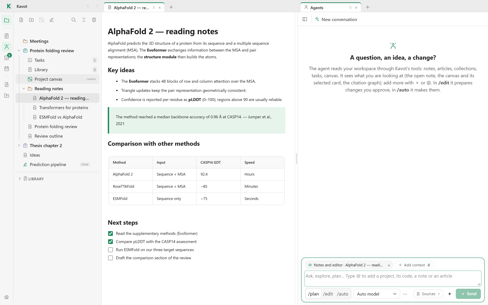

# 💬 Agents

The **Agents** page lets you talk to an agent already installed on your
computer about what you are working on: the open note, a canvas and its
selected card, the citation graph, a project or your library. The agent reads
your workspace through Kavot's tools, and in `/edit` it only *proposes* changes,
which you approve before anything is written.

## Connect an agent

Kavot works with three agent tools:

- **Claude Code**: sign in with your Claude account or an Anthropic API key.
- **Codex**: sign in with your ChatGPT account or an OpenAI API key.
- **OpenCode**: connect the providers you want (Anthropic, OpenAI, local
  models…).

Install one of them, then enable it in **Settings → Agents**. There you can also
set the program path, the model and its effort, sign in, update the tool and
check the installation.

## Chat next to your work

Open **Agents** from the ribbon. Right-click the icon and choose **Open to the
side** to keep it beside a note, a canvas or the library: the agent then follows
the tab open in the other pane. The context it receives is shown above the
message box (for example *Notes and editor · AlphaFold 2 — reading notes*); add
more with **Add context** or by typing `@` to pick a project, a note or an
article.

**Conversations** on the left keeps every conversation. With Claude Code, Kavot
keeps one agent process per conversation between messages, so follow-up
questions are fast and cheap.

## Three modes

| Mode | What the agent does |
| --- | --- |
| `/plan` | Answers and plans, without changing anything. |
| `/edit` | Prepares changes to notes, tasks, canvases and other items. Each change is listed in the chat and can be applied or dismissed. |
| `/auto` | Makes the changes directly. |

**Sources** shows what the agent read to answer.

## Terminal

The **Terminal** page (from a new tab) runs an agent CLI in a terminal with all
its own options, on the whole workspace. It is an advanced alternative to the
chat.

## How the agent reads your workspace

Kavot runs a local [MCP server](../app/docs/mcp-local.md) on the loopback
interface while the app is open. Each conversation gets its own token. The
agent searches a local index of your notes, articles, PDF pages and files, and
opens only the passages it needs. Repeated reads of something that did not
change are answered with "unchanged", which keeps conversations short.

[← Back to the README](../README.md#features)
