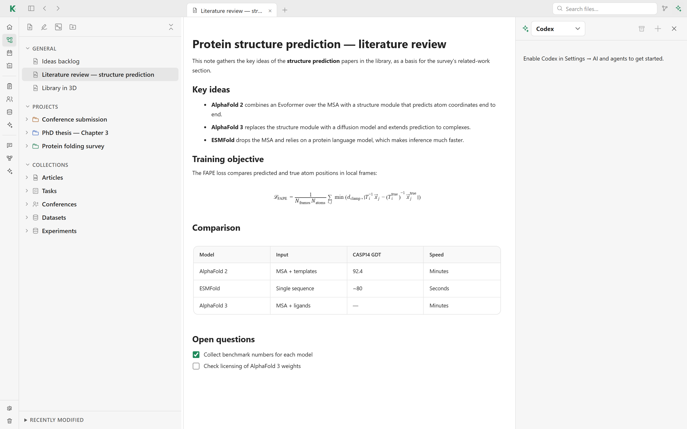

# 💬 Assistant

The assistant lets you talk to an agent already installed on your computer
about what you are working on: the open note, a project or your library. The
agent can read your workspace, but it only *proposes* changes, which you
approve before anything is written.

## Connect an agent

Kavot works with three agent tools:

- **Claude Code**: sign in with your Claude account or an Anthropic API key.
- **Codex**: sign in with your ChatGPT account or an OpenAI API key.
- **OpenCode**: connect the providers you want (Anthropic, OpenAI, local
  models…).

Install one of them, then enable it in **Settings → AI and agents**. There you
can also set the program path, the model and its intelligence level, sign in,
update the tool, and check the installation.

## Two places to chat

- The **assistant panel** opens beside any view with the ✦ button in the title
  bar. It knows what is on screen, such as the open note or project.
- The **Chat** page in the sidebar keeps all your conversations, with search.

You can attach files to a message and switch between agents from the panel
header.

## Plan or edit

Type `/plan` or `/edit` in the chat. In `/plan` the agent answers and plans
without changing anything. In `/edit` it can propose changes to notes, tasks,
collections and other items; each change is listed and can be reviewed, then
applied or dismissed.

## How the agent reads your workspace

For each run, Kavot starts a local [MCP server](../app/docs/mcp-local.md) on
the loopback interface, with a random token and a fresh port. The agent reads
your workspace through it and submits its proposals there. The server has no
tool to approve, delete or write files directly, and it stops at the end of
the run.

Agents search a local index of your notes, articles, PDF pages, files and
collections, the **Workspace map** in **Settings → AI and agents**, and open
only the passages they need. When an agent reads a long item in full, it can
keep a summary for later requests; the summary is hidden as soon as its source
changes.

[← Back to the README](../README.md#features)
