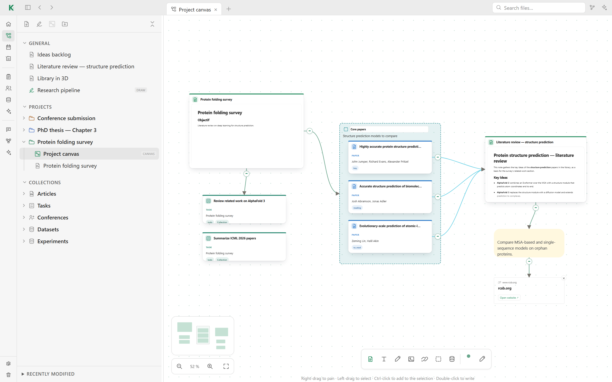
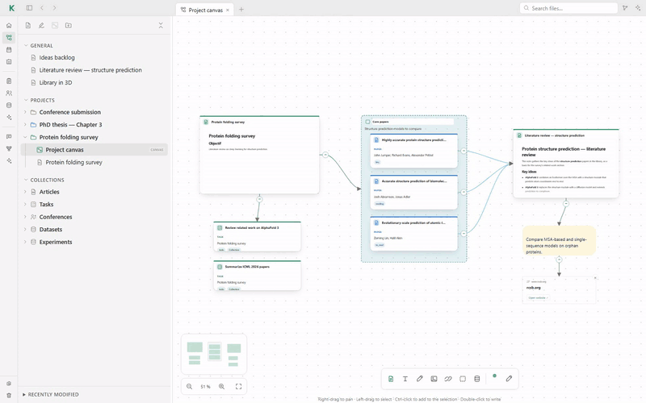

# 🧭 Canvases

Each project opens on its own canvas: an infinite board where you lay out the
notes, articles, tasks and ideas of the project and draw the links between
them. Open a project in **Workspace**, then its **Project canvas**.

Moving a zone carries the cards inside it, and links follow their cards.
Right-drag anywhere to pan:

## Cards

The toolbar at the bottom of the canvas adds:

- **notes**, shown with their content;
- **text** cards for quick ideas (or double-click the canvas to write);
- **drawings**, edited in the same drawing studio as
  [drawing notes](notes.md#drawings);
- **images** and other files;
- **links** to web pages;
- **zones**, which group cards under a title and a description;
- **collections**, such as the articles or tasks of the project.

You can also drag articles, tasks, conferences, datasets, notes or files from
the tree, or drop a URL or a file on the canvas. Placing an article creates its
reading note.

Dropping a project, or another canvas, from the tree adds a frame that shows that
canvas live, with its cards and links at full size. Any change to the source
canvas (new cards, moves, links) appears in the frame. Its cards can be linked
to the cards of this canvas like any other; they are edited in their source:
double-click one, or the frame, to open it. Moving the frame carries its cards.

## Links

Drag from the edge of a card to another card to link them. Links show how
ideas, sources and tasks depend on each other, and they appear in the global
graph.

## Moving around

- Right-drag to pan, left-drag to select, Ctrl-click to add to the selection.
- Zoom with the buttons or the mouse wheel; the full-screen button fits the
  canvas to the window.
- The minimap in the corner shows where you are.
- Dragging a zone moves the cards inside it.
- Delete, the × of a selected card, or right-click → Remove removes every
  selected card at once.

## On disk

A canvas is a JSON file (`main.canvas`) in the project folder, under
`projects/`.

[← Back to the README](../README.md#features)
