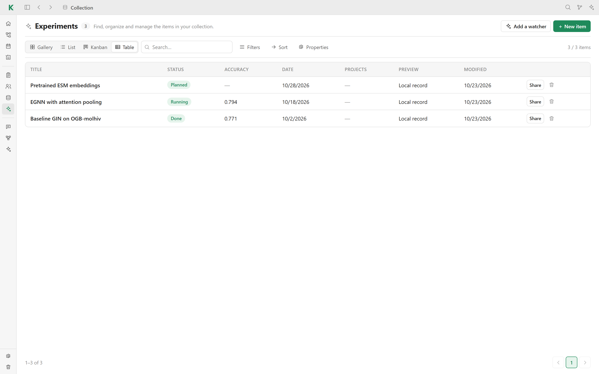

# 🗂️ Collections

Collections hold anything your research needs to track and that Kavot does not
know yet: experiments, interviews, samples, grants, code… You define their
fields, and Kavot gives them the same views and tools as the built-in
collections.

## Create a collection

Click **＋** next to **Collections** in the sidebar, or go to
**Settings → Collections**. Give the collection a name and an icon, then add
its fields:

| Field | Use |
| --- | --- |
| **Text** / **Long text** | A short line or a paragraph |
| **Web link** | A clickable link |
| **Email** | An email address |
| **Choice** | One value from a list you define |
| **Number** | Can be sorted and filtered by value |
| **Checkbox** | Yes or no |
| **Date** | Picked from a calendar |
| **Tags** | Several labels |
| **List** | Rows with the columns you define, like the deadlines of a conference |

Fields can be required and can have a default value.

## Views

- **Gallery**, **List**, **Kanban** and **Table**.
- **Filters** (contains, is, is not, is empty, greater or less than…),
  **Sort** and **Properties** (which fields are shown, and in which order).
- Search the collection from the toolbar.

## Items

**New item** asks for the title (and the required fields), then opens the item
in a side panel. An item is laid out like a page: its fields in a table you
edit in place, then a free text, like a note. **Open in Notes** moves it to a
tab of the workspace.

Items can be linked to projects, shared, placed on a [canvas](canvases.md) and
embedded in [notes](notes.md). **Add a watcher** creates a
[watcher](watchers.md) that fills the collection for you.

## On disk

Each collection is a folder in `databases/` with one JSON file per item, which
you can read or process without Kavot.

[← Back to the README](../README.md#features)
