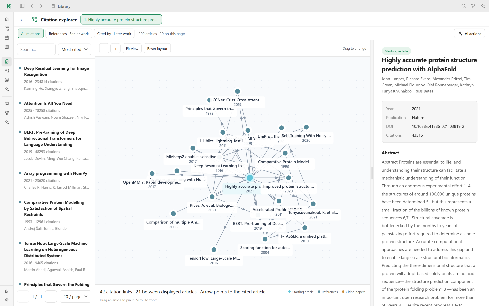

# 🔎 Discovery

The citation explorer maps the references and citations around an article, so
you can find the papers that matter and add them to your library in one click.

## Start an exploration

- In the [library](library.md), click **Graph** on an article.
- Or type a DOI or an article URL in **Explore a DOI or URL…** at the top of
  the library. **Look up** previews the article first.

## Read the graph

- **All relations**, **References · Earlier work** and **Cited by · Later
  work** choose which articles are shown.
- The list on the left can be searched, sorted (for example by **Most cited**)
  and paged.
- In the graph, the starting article is highlighted and arrows point to the
  cited article. Drag an article to pin it, scroll to zoom, and use **Fit
  view** or **Reset layout** to tidy up.
- Selecting an article shows its details on the right: authors, year,
  publication, DOI, citation count and abstract. From there you can import it
  into your library or continue the exploration from it.
- **AI actions** sends the displayed articles to your connected agent, for
  example to analyze the set.

## Explorations are saved

Every exploration is saved automatically, including the steps you took from one
article to the next. They are listed under **Graph explorations** on the right
of the library, where you can resume or delete them.

## Sources

Discovery queries scholarly APIs such as OpenAlex, Semantic Scholar and
OpenCitations. API keys are optional and can be set in
**Settings → Plugins → Papers** or with `OPENALEX_API_KEY`,
`SEMANTIC_SCHOLAR_API_KEY` and `OPENCITATIONS_ACCESS_TOKEN`.

This is an online feature: it only runs when you open an exploration.

[← Back to the README](../README.md#features)
