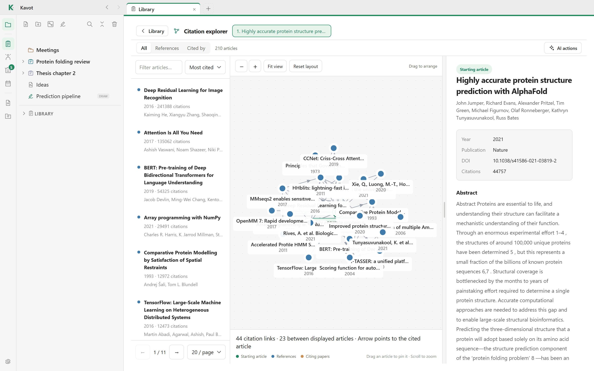

# 🔎 Discovery

The citation explorer maps the references and citations around an article, so
you can find the papers that matter and add them to your library in one click.

## Start an exploration

In the [library](library.md), open the **⋯** menu of an article and choose
**Explore citations**.

## Read the graph

- **All**, **References** and **Cited by** choose which articles are shown.
- The list on the left can be filtered, sorted (for example by **Most cited**)
  and paged.
- In the graph, the starting article is highlighted and arrows point to the
  cited article. Drag an article to pin it, scroll to zoom, and use **Fit
  view** or **Reset layout** to tidy up.
- Selecting an article shows its details on the right: authors, year,
  publication, DOI, citation count and abstract. From there you can import it
  into your library or continue the exploration from it. The trail of articles
  you followed stays at the top.
- **AI actions** sends the displayed articles to your [agent](assistant.md),
  for example to analyze the set. The agent also sees the graph when you ask it
  a question from the Agents page.

## Explorations are saved

Every exploration is saved automatically, including the steps you took from one
article to the next. The **Saved citation explorations** button, next to
**Add** in the library header, lists them so you can resume or delete them.

## Sources

Discovery queries scholarly APIs such as OpenAlex, Semantic Scholar and
OpenCitations. API keys are optional and can be set in **Settings → Library**,
or with `OPENALEX_API_KEY`, `SEMANTIC_SCHOLAR_API_KEY` and
`OPENCITATIONS_ACCESS_TOKEN`.

This is an online feature: it only runs when you open an exploration.

[← Back to the README](../README.md#features)
