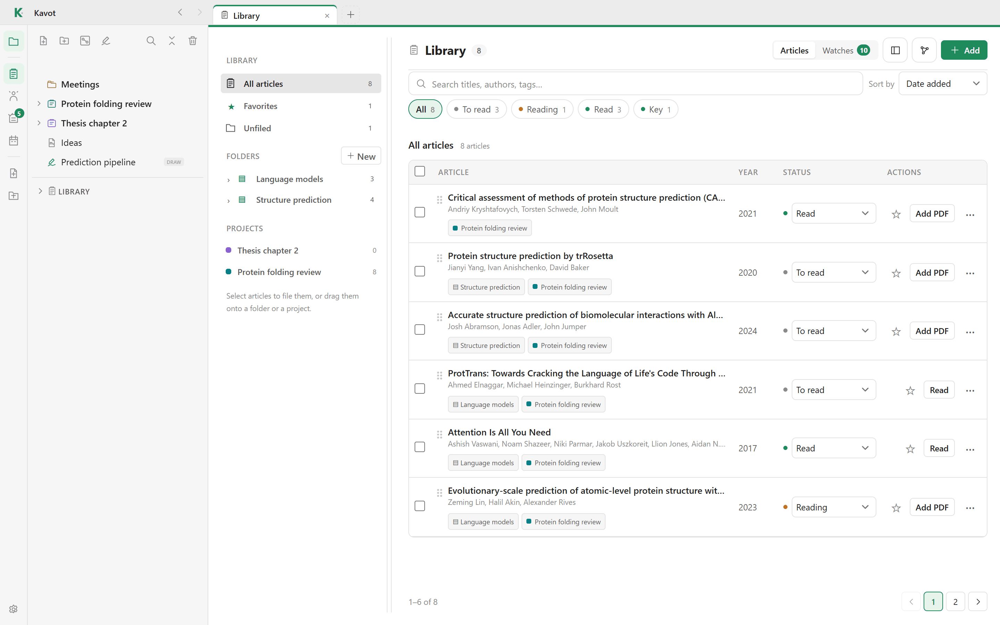
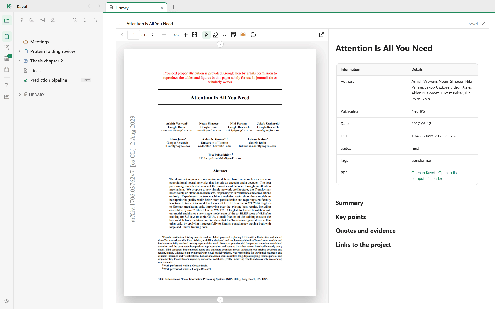
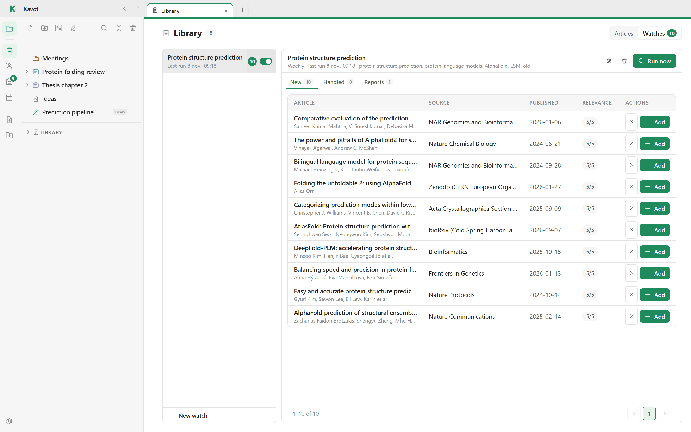

# 📚 Library

The library holds every article of your workspace: its metadata, its PDF, your
reading status and your reading note. Open it from the **Library** icon of the
ribbon, or from **Library** at the bottom of the tree. Inside a project, the
project's own **Library** lists only the articles linked to it.

## Organize

- **All articles**, **Favorites** and **Unfiled** sit at the top of the left
  panel, each with its article count.
- **Folders** can be nested. Drag a folder to move it, or drop it on the
  **Folders** heading to move it to the top level.
- **Projects** list the articles linked to a project. Drag articles onto a
  folder or a project to file them; dropping a folder on a project links all
  its articles.
- The left panel can be hidden with the button next to **Add**.

## Find

- Search by title, author, DOI or tag.
- Filter by reading status (**To read**, **Reading**, **Read**, **Key**).
- Sort by date added, title or year.

## Add articles

**Add** opens a dialog with four ways in:

- **Link or DOI** fetches the metadata from a DOI, an article URL or an arXiv
  identifier. You can check and edit it before saving.
- **PDF files** imports PDFs you already have.
- **Manual entry** lets you type the title, authors, publication, date, DOI,
  URL, folder, tags, abstract and projects yourself.
- **Zotero** syncs a Zotero library, including PDFs and notes. Set your
  credentials in **Settings → Library**, or with `KAVOT_ZOTERO_API_KEY` and
  `KAVOT_ZOTERO_USER_ID`.

**Add PDF** on an article row attaches a PDF to an existing article.

## Read and annotate

**Read** opens the built-in reader in a tab, with the article's reading note
beside it. You can highlight, underline, add sticky notes and capture a region
of a page. Annotations are saved with the article, and Kavot remembers where
you stopped reading.

The reading note is a regular [note](notes.md) linked to the article, with
ready-made sections (summary, key points, quotes, links to the project). You can
also place it on a project [canvas](canvases.md).

## Explore citations

**⋯ → Explore citations** on an article opens the citation explorer. See
[Discovery](discovery.md).

## Watches

**Watches**, at the top right of the library, keeps an eye on the literature
for you. A watch has a subject, keywords and example folders; every week it
searches the literature and suggests the new articles that match.

- **New** lists the suggestions with their source, date and relevance. **Add**
  puts an article in the library, **×** dismisses it.
- **Handled** keeps what you already decided, **Reports** the summary of each
  run.
- **Run now** starts a search immediately; the switch next to a watch pauses
  it.

Watches query OpenAlex and need no agent. Semantic ranking against your example
articles uses local embeddings (`pip install -e ".[semantic]"`).

## On disk

Articles and their PDFs are stored in `library/` in your workspace folder, one
folder per article.

[← Back to the README](../README.md#features)
