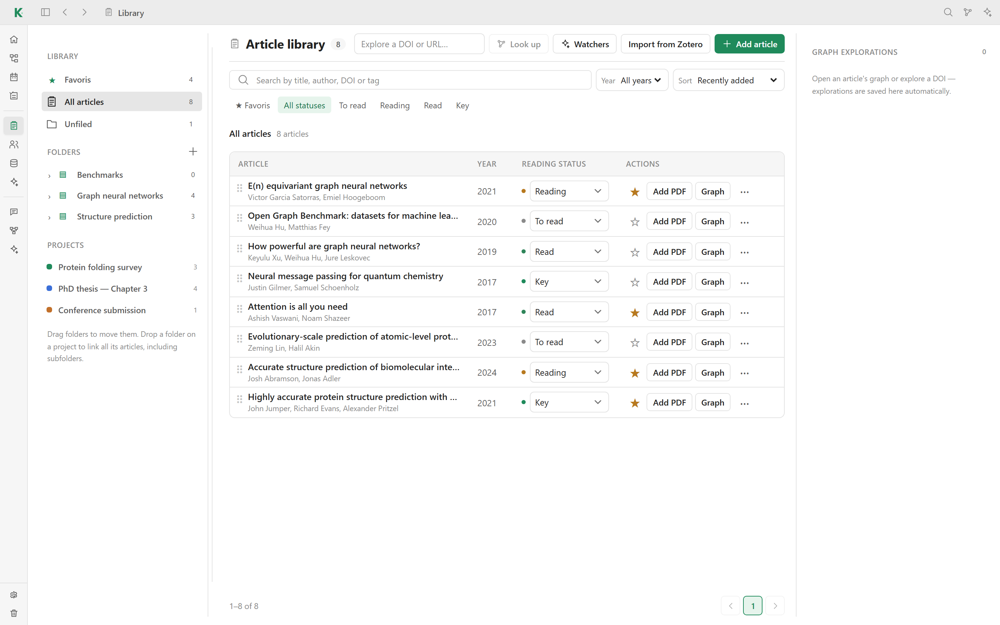

# 📚 Library

The library holds every article of your workspace: its metadata, its PDF, your
reading status and your reading note. Open it from **Library** in the sidebar.

## Organize

- **Favorites**, **All articles** and **Unfiled** sit at the top of the left
  panel, each with its article count.
- **Folders** can be nested. Drag a folder to move it, or drop it on the
  **Folders** heading to move it to the top level.
- **Projects** list the articles linked to a project. Drop a folder on a
  project to link all its articles, including those in subfolders.
- The folder panel can be resized: drag its edge, or double-click the edge to
  reset it.

## Find

- Search by title, author, DOI or tag.
- Filter by reading status (**To read**, **Reading**, **Read**, **Key**), by
  year, or show favorites only.
- Sort by date added, title or year.

## Add articles

- **Add article → Quick add** fetches the metadata from a DOI, an article URL
  or an arXiv identifier. You can check and edit it before saving.
- **Add article → Manual entry** lets you type the title, authors,
  publication, date, DOI, URL, folder, tags, abstract and projects yourself,
  and attach a PDF.
- **Import from Zotero** syncs a Zotero library, including PDFs and notes. A
  report shows how many articles were added, updated or skipped, and which
  ones need attention. Set your Zotero credentials in
  **Settings → Plugins → Papers** or with `KAVOT_ZOTERO_API_KEY` and
  `KAVOT_ZOTERO_USER_ID`.
- **Add PDF** on an article row attaches a PDF to an existing article.

## Read and annotate

Opening an article with a PDF shows the built-in reader. You can highlight,
underline and add sticky notes. Annotations are saved with the article, and
Kavot remembers where you stopped reading; **Research Home** offers to resume.

Each article has its own reading note, a regular [note](notes.md) linked to the
article, which you can also place on a project [canvas](canvases.md).

## Explore

The **Graph** button of an article, or **Explore a DOI or URL…** in the header,
opens the citation explorer. See [Discovery](discovery.md).

## On disk

Articles and their PDFs are stored in `library/` in your workspace folder, one
folder per article.

[← Back to the README](../README.md#features)
