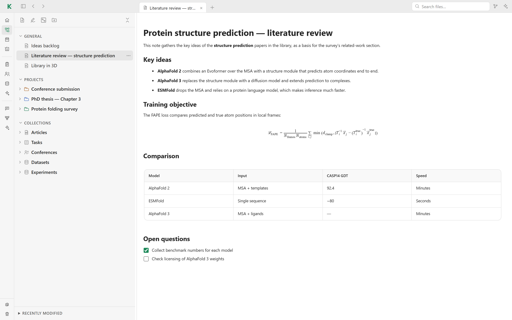
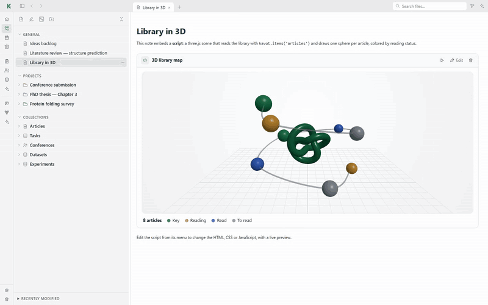
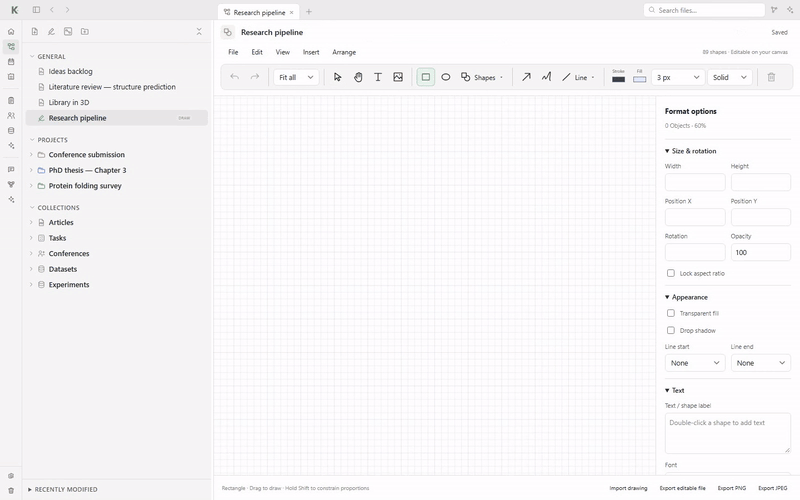

# 📝 Live notes

Notes are standalone HTML documents edited with a rich editor. They open in any
browser, even without Kavot. Open **Workspace** in the sidebar to browse your
notes, projects and collections in a tree, with tabs for the open notes.



## Writing

- The toolbar groups text formatting, paragraph options and insertion
  commands. Right-click a block (or press Shift+F10) for the same commands.
- **Edit** and **Read** switch between editing and a read-only view
  (Ctrl+E). Changes are saved automatically.
- Drag the ⠿ handle on the left of a block to move it; click it for the block
  menu.
- Insert headings, lists, checklists, quotes, dividers, images, media,
  side-by-side columns and collapsible sections.
- Math is rendered locally with KaTeX: `$…$` inline, `$$…$$` for a block.

## Tables

Tables have a header row, **+** buttons to add rows and columns, Tab and
Shift+Tab navigation, merged cells and several styles (standard, striped,
minimal, compact, colored header).

## Live collection views

**Insert → Collection** embeds a collection (notes, articles, tasks,
conferences, datasets or one of your own) as a **table**, **list**,
**gallery** or **kanban** board. Choose the fields, filters, sort order and
grouping. Views stay live: they refresh when the collection changes, and
dragging a kanban card updates the item.

## Scripts

**Insert → Script** adds a small HTML, CSS and JavaScript program to a note,
with a live preview: a chart, a timer, a table of contents, a calendar, a task
counter… Scripts run in an isolated frame with no direct access to the app or
the network. They read your collections through a small `kavot` API, and can
only reach a URL you approved. Scripts can be saved to a library, shared and
imported.

### Example: the library in 3D

Scripts can import libraries from cdn.jsdelivr.net, unpkg.com, esm.sh or
cdnjs. This note loads [three.js](https://threejs.org), reads the library with
`kavot.items('articles')` and draws one sphere per article on a rotating
helix, colored by reading status. The scene is live: add or read an article and
it updates with the note.



<details>
<summary><b>The script</b> (HTML, CSS and JavaScript tabs of the script editor)</summary>

**HTML**

```html
<div id="scene"></div>
<div class="legend"><strong id="count"></strong>
  <span><i style="background:var(--accent)"></i>Key</span>
  <span><i style="background:#e0a23a"></i>Reading</span>
  <span><i style="background:#3b6fd8"></i>Read</span>
  <span><i style="background:#9aa4ad"></i>To read</span>
</div>
```

**CSS**

```css
body { margin: 0; font: 13px system-ui, sans-serif; color: var(--text, #1d252c); }
#scene { height: 420px; border-radius: 12px; background: radial-gradient(circle at 50% 30%, #ffffff, #eef3f1); }
.legend { display: flex; gap: 16px; align-items: center; padding: 10px 4px 2px; flex-wrap: wrap; }
.legend i { display: inline-block; width: 10px; height: 10px; border-radius: 50%; margin-right: 6px; vertical-align: -1px; }
```

**JavaScript**

```js
import * as THREE from 'https://cdn.jsdelivr.net/npm/three@0.160.0/build/three.module.js';

const root = document.getElementById('scene');
const css = getComputedStyle(document.documentElement);
const accent = css.getPropertyValue('--accent').trim() || '#1f8a5b';
const colors = { key: accent, reading: '#e0a23a', read: '#3b6fd8', to_read: '#9aa4ad' };

// One sphere per article of the library, colored by reading status.
const papers = await kavot.items('articles');
document.getElementById('count').textContent = `${papers.length} articles`;

const scene = new THREE.Scene();
const camera = new THREE.PerspectiveCamera(45, root.clientWidth / root.clientHeight, 0.1, 100);
camera.position.set(0, 2.6, 8.5);
camera.lookAt(0, 0.1, 0);
const renderer = new THREE.WebGLRenderer({ antialias: true, alpha: true });
renderer.setPixelRatio(window.devicePixelRatio);
renderer.setSize(root.clientWidth, root.clientHeight);
root.appendChild(renderer.domElement);

scene.add(new THREE.AmbientLight(0xffffff, 0.55));
const sun = new THREE.DirectionalLight(0xffffff, 1.4);
sun.position.set(4, 8, 6);
scene.add(sun);

const world = new THREE.Group();
scene.add(world);
const grid = new THREE.GridHelper(12, 24, 0xc9d1d6, 0xe3e8eb);
grid.position.y = -2.2;
scene.add(grid);

// A helix of articles linked in reading order.
const points = [];
papers.forEach((paper, i) => {
  const t = i / Math.max(1, papers.length - 1);
  const angle = t * Math.PI * 3.2;
  const position = new THREE.Vector3(Math.cos(angle) * 2.6, t * 3.6 - 1.6, Math.sin(angle) * 2.6);
  points.push(position);
  const status = String(paper.fields?.status || 'to_read');
  const mesh = new THREE.Mesh(
    new THREE.SphereGeometry(status === 'key' ? 0.42 : 0.3, 48, 32),
    new THREE.MeshStandardMaterial({ color: colors[status] || colors.to_read, roughness: 0.35, metalness: 0.1 }),
  );
  mesh.position.copy(position);
  mesh.userData.phase = i;
  world.add(mesh);
});
world.add(new THREE.Mesh(
  new THREE.TubeGeometry(new THREE.CatmullRomCurve3(points), 200, 0.03, 8, false),
  new THREE.MeshStandardMaterial({ color: 0x8a96a0, transparent: true, opacity: 0.6 }),
));
const core = new THREE.Mesh(
  new THREE.TorusKnotGeometry(0.7, 0.18, 160, 24),
  new THREE.MeshStandardMaterial({ color: accent, roughness: 0.25, metalness: 0.4 }),
);
world.add(core);

const clock = new THREE.Clock();
renderer.setAnimationLoop(() => {
  const t = clock.getElapsedTime();
  world.rotation.y = t * 0.45;
  core.rotation.x = t * 0.8;
  core.rotation.z = t * 0.5;
  world.children.forEach(child => {
    if (child.userData.phase !== undefined) child.scale.setScalar(1 + Math.sin(t * 2.4 + child.userData.phase) * 0.08);
  });
  renderer.render(scene, camera);
});
new ResizeObserver(() => {
  camera.aspect = root.clientWidth / root.clientHeight;
  camera.updateProjectionMatrix();
  renderer.setSize(root.clientWidth, root.clientHeight);
}).observe(root);
```

</details>

## Drawings

A drawing is a note of its own, made in the **Drawing studio**: diagrams,
sketches, figures for a paper. Create one with the ✎ button (**New Draw
diagram**) at the top of the Workspace tree; drawings are marked **DRAW** in the tree. The
same studio opens from a drawing card on a [canvas](canvases.md).



- **Shapes**: rectangle, ellipse and a library of 89 shapes with search.
- **Lines**: arrows, straight lines, elbow and curved connectors, polylines,
  curves and freehand strokes.
- **Text** boxes, and text inside any shape (double-click it).
- **Images** from your computer.
- **Format options**: stroke and fill colors, weight and dash, size, position,
  rotation, opacity, shadow, line ends, font and text alignment.
- **Arrange**: bring forward or send back, align and distribute.
- Grid and snap to grid, zoom, pan, undo and redo, copy, paste and duplicate.
- **Export** as PNG or JPEG, or as an editable file you can import again.

Shortcuts: **V** select, **T** text, **R** rectangle, **O** ellipse,
**A** arrow, **P** freehand.

## More

The full reference, including every shortcut, the script API and the network
rules, is in the [note editor guide](../frontend/NOTE_EDITOR.md).

## On disk

Notes are stored as HTML files in `notes/` and in the project folders of your
workspace.

[← Back to the README](../README.md#features)
