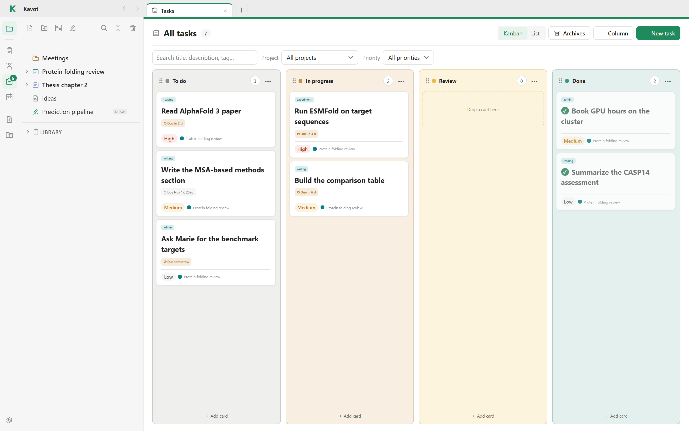
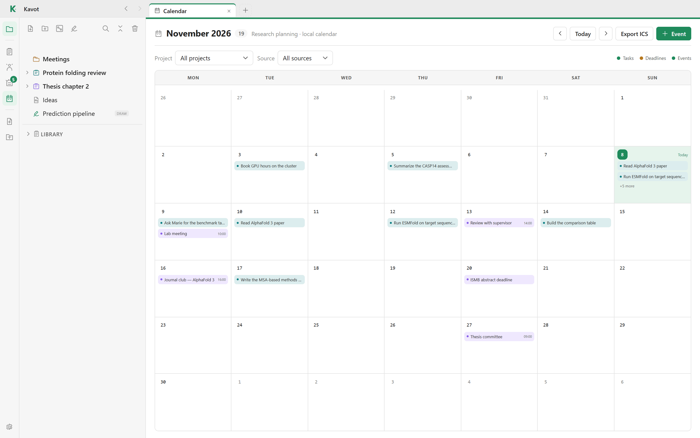

# ✅ Planning

Kavot keeps the practical side of research next to the research itself: tasks
and a calendar, linked to your projects. Open them from the **Tasks** and
**Calendar** icons of the ribbon. The Tasks icon shows the number of open tasks.
Inside a project, its own **Tasks** entry in the tree shows only the tasks of
that project.

## Tasks

- Switch between a **Kanban** board and a **List**.
- Columns can be added, renamed, reordered and colored; drag cards between
  them.
- Each task has a title, a description, a project, a priority, labels, a
  checklist, and start and due dates. Due dates appear as badges (overdue, due
  today, due in 3 days…).
- Search tasks and filter them by project or priority.
- Done tasks can be archived; **Archives** lists them and restores them.

## Calendar

The calendar shows tasks, deadlines and events on a monthly grid. Filter it by
project or by source, add events with **Event**, and use **Export ICS** to open
your schedule in another calendar app.

[← Back to the README](../README.md#features)
