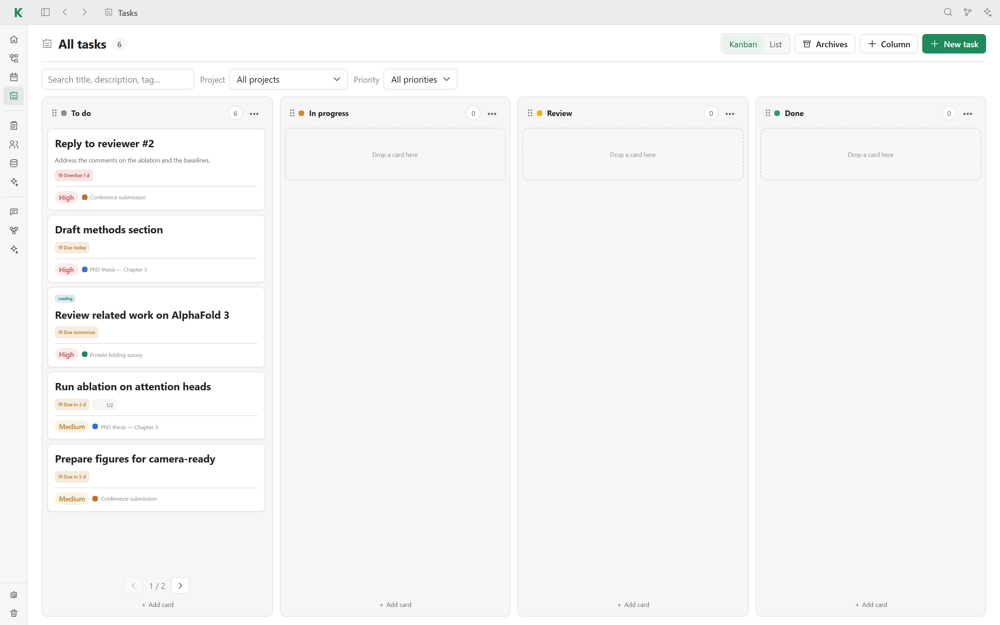
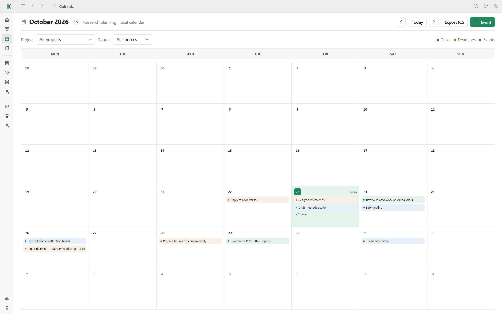
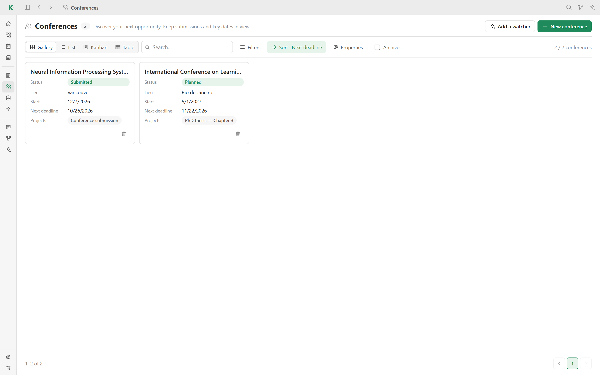

# ✅ Planning

Kavot keeps the practical side of research next to the research itself: tasks,
a calendar, conferences and datasets, all linked to your projects.

## Research Home

**Research Home** is the first screen. It shows overdue tasks, what is due
today and in the next 7 days, the article you were reading, this week's tasks,
the agenda for the next 30 days, your projects and your recent notes.

## Tasks

- Switch between a **Kanban** board and a **List**.
- Columns can be added, renamed, reordered and colored; drag cards between
  them.
- Each task has a title, a description, a project, a priority, labels, a
  checklist, and start and due dates. Due dates appear as badges (overdue, due
  today, due in 3 days…).
- Search tasks and filter them by project or priority.
- Done tasks can be archived; **Archives** lists them and restores them.

## Calendar

The calendar shows tasks, deadlines and events on a monthly grid. Filter it by
project or by source, add events with **Event**, and use **Export ICS** to open
your schedule in another calendar app.

## Conferences and datasets

**Conferences** track the events you target: acronym, edition, location, dates,
status, a list of deadlines, and the linked projects and datasets. Their
deadlines appear in the calendar.

**Datasets** record the data you use: description, URL, license, version,
local path, access status, and the linked projects and conferences.

Both are [collections](collections.md), so they have the same gallery, list,
kanban and table views, filters, sorting and watchers. They can be turned off
in **Settings → Plugins → Research**.

[← Back to the README](../README.md#features)
