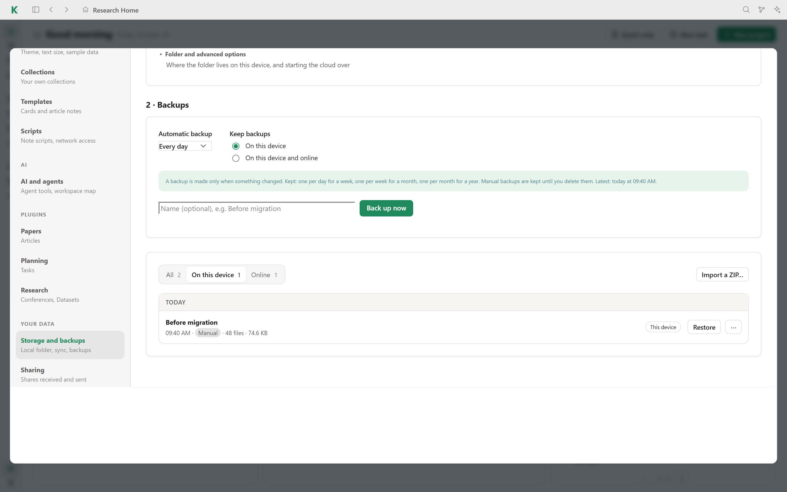
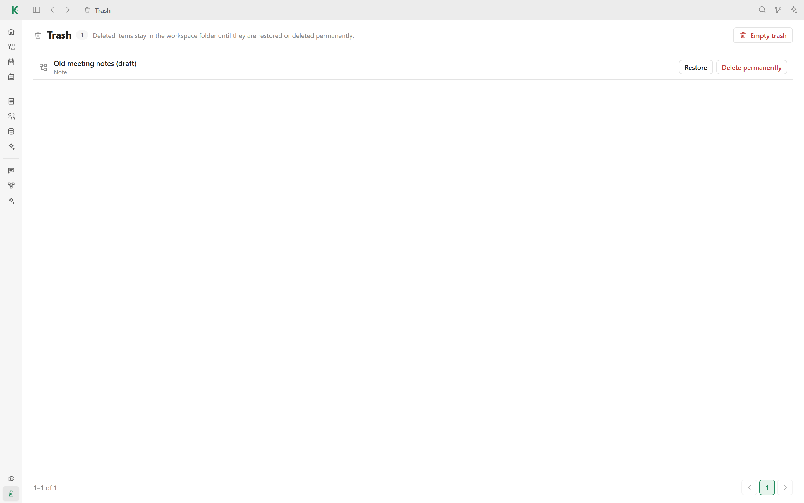

# 💾 Safety

Your workspace is a folder of plain files, and Kavot adds several layers so you
do not lose any of them: local backups, a restorable trash, archives and
optional cloud sync.

## Backups

In **Settings → Storage and backups**:

- **Automatic backup** saves a dated ZIP of the whole workspace on a schedule.
  A backup is made only when something changed. Kavot keeps one per day for a
  week, one per week for a month and one per month for a year.
- **Back up now** makes a manual backup, with an optional name such as
  "Before migration". Manual backups are kept until you delete them.
- **Restore** brings a backup back; **Import a ZIP…** adds a backup made
  elsewhere.
- **Keep backups** chooses between this device only, or this device and
  [Kavot Cloud](../README.md#kavot-cloud).

Local backups are stored in `.kavot-backups/` in your workspace.

## Trash

Deleted notes, files and projects go to the **Trash** at the bottom of the
sidebar. They stay in the workspace folder (in `.meta_kavot/`) until you
**Restore** them or **Delete permanently**.

## Archives

**Settings → Archive** lists archived and deleted projects and archived tasks,
and restores them.

## Cloud sync (optional)

With a Kavot Cloud account, **Settings → Storage and backups → Sync** keeps the
same files on every linked device. Each file keeps its own version history, so
you can restore an earlier version of a single file. When a file changed on two
devices, Kavot lists the conflict and lets you compare the versions before
choosing one.

## Always readable

Everything stays readable without Kavot: notes are HTML, PDFs are PDFs, and the
rest is JSON. See [Your data](../README.md#your-data) for the folder layout.

[← Back to the README](../README.md#features)
