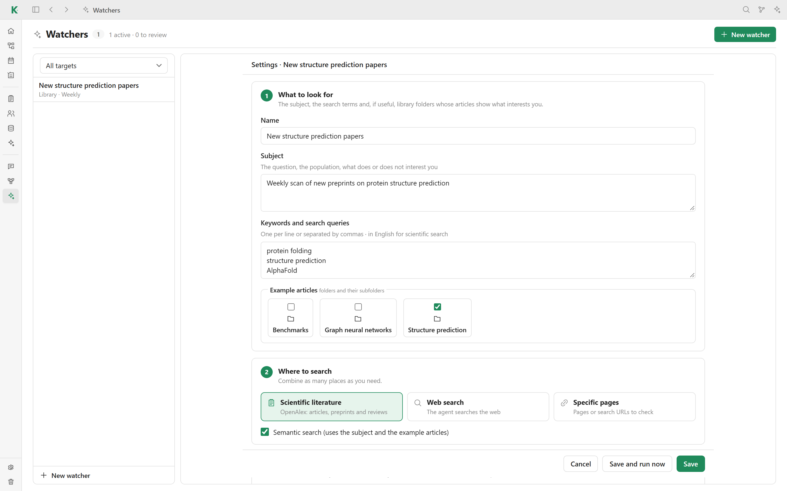

# 🛰️ Watchers

A watcher keeps an eye on a subject for you. On a schedule, it searches for new
articles, conferences or any other items, then proposes them for a collection
or a note. Open **Watchers** in the sidebar, or click **Add a watcher** on the
page of a collection.

## Set up a watcher

1. **What to look for**: a name, the subject (the question, the population,
   what does or does not interest you), keywords and search queries, and
   optionally library folders whose articles show what you like.
2. **Where to search**: combine as many sources as you need.
   - **Scientific literature**: OpenAlex articles, preprints and reviews.
   - **Web search**: the agent searches the web.
   - **Specific pages**: pages or search URLs to check.

   **Semantic search** ranks the results against the subject and the example
   articles. It uses local embeddings (`pip install -e ".[semantic]"`).
3. **Where results go**: the Library, any other [collection](collections.md),
   or a note (added at the top or at the end).
4. **How**: review each result first or add them automatically, allow updates
   of existing items, set a maximum number of items per run, the schedule
   (manual, every 6 or 12 hours, daily, every 3 days, weekly or monthly), the
   agent, its model and its effort.

**Save and run now** saves the watcher and starts a first run.

## Follow the results

Each watcher has several tabs:

- **Suggestions**: new items waiting for your decision. Accept or dismiss them.
- **Reports**: what the agent wrote about each run.
- **Handled**: items already accepted or dismissed.
- **Runs**: the history of runs and what each one did.

**Run now** starts a run immediately, **Pause** stops the schedule. Deleting a
watcher keeps the items it already added.

A watcher that only searches the scientific literature for the Library runs
without an agent. The other sources need an agent enabled in
**Settings → AI and agents**.

[← Back to the README](../README.md#features)
