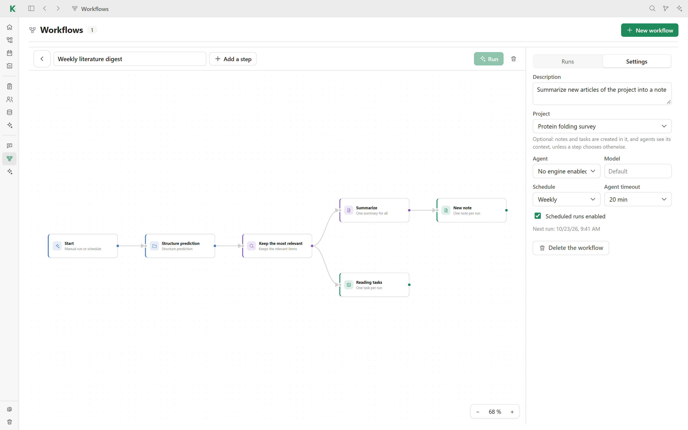

# ⚙️ Workflows

A workflow chains sources, agent steps and outputs on a canvas. Run it by hand
or on a schedule: each run keeps the input and output of every step, and the
changes it proposes wait for your approval. Open **Workflows** in the sidebar.

## Build a workflow

Click **New workflow**, then **Add a step**, and link the steps by dragging
from one node's output to the next node's input. A step can feed several
others, as in the example above.

### Sources

| Step | What it passes on |
| --- | --- |
| **Start** | Starts the workflow, manually or on its schedule |
| **Watcher** | Runs a [watcher](watchers.md) and passes on what it found |
| **Collection** | Items of a collection, with filters |
| **Note** | The content of a note |
| **Project** | Articles, notes and tasks of a project |
| **Article folder** | Articles of a library folder, with or without subfolders |
| **Local folder** | Files of a folder on your computer (code, data…) |

### Agent steps

| Step | What it does |
| --- | --- |
| **Summarize** | One summary per item, or one for all of them |
| **Filter and sort** | Keeps and ranks the items by your criteria |
| **Extract fields** | Precise data for each item, as fields |
| **Compare** | A comparison table and an analysis of all the items |
| **Build** | A synthesis or a structure built from the items |
| **Agent task** | Any task you write yourself |

### Outputs

| Step | What it produces |
| --- | --- |
| **Fill a collection** | Adds or updates items, the Library included |
| **Update a note** | Adds or replaces a section of a note |
| **New note** | A new note on each run, or one per item |
| **Create tasks** | Tasks on the board |
| **File articles** | Files the incoming articles in a library folder |
| **Change local files** | Proposes file changes; you approve each diff |

## Settings

The **Settings** tab of a workflow sets its description, an optional project
(notes and tasks are created in it, and agents see its context), the agent and
its model, the schedule (manual, every 6 or 12 hours, daily, every 3 days,
weekly or monthly) and the agent timeout. Uncheck **Scheduled runs enabled**
to keep a workflow manual for a while.

## Runs

**Run** starts the workflow. The **Runs** tab shows each run step by step:
status, duration, the items each step received and produced, the agent's calls
and a log. Proposed changes are listed with their diff; apply or dismiss each
one.

Agent steps need an agent enabled in **Settings → AI and agents**.

[← Back to the README](../README.md#features)
